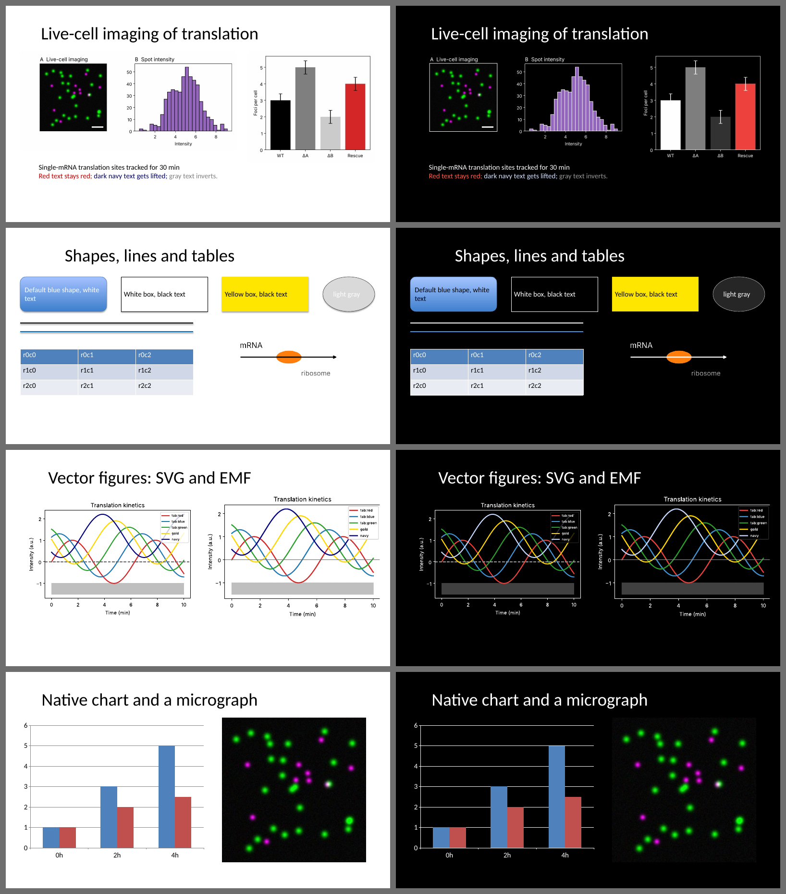

# blackslides

Converts a PowerPoint deck (or individual figure files) so it reads well on a black background. It does in one step what you were doing by hand with ezreverse: black lines become white, greys are reversed, and colours keep their hue.



## Installation

You need Python 3.9 or newer and Git.

### Windows (for example, in the Visual Studio Code terminal)

Open the terminal in VS Code with **Ctrl+`**.

**1. Check that Python and Git are installed:**

```
py --version
git --version
```

- If Python is missing, install it from [python.org](https://www.python.org/downloads/) and tick **"Add python.exe to PATH"** in the installer.
- If Git is missing, install it from [git-scm.com](https://git-scm.com/download/win) with the default options.

Restart VS Code after installing either one.

**2. Install blackslides:**

```
py -m pip install "git+https://github.com/timstasevich/blackslides.git"
```

If Git asks you to sign in to GitHub, a browser window opens. Approve it.

**3. Convert a deck:**

```
py -m blackslides "C:\Users\you\Desktop\talk.pptx"
```

This writes `talk_black.pptx` next to the original. To get a file's path, Shift+right-click it in File Explorer, choose **Copy as path**, and paste it into the terminal.

If PowerPoint has `talk_black.pptx` open, close it before re-running, otherwise Windows blocks the save.

**Updating to the latest version:**

```
py -m pip install --upgrade --force-reinstall "git+https://github.com/timstasevich/blackslides.git"
```

### macOS / Linux

```
python3 -m pip install --user "git+https://github.com/timstasevich/blackslides.git"
python3 -m blackslides talk.pptx
```

If you get an `externally-managed-environment` error, install with pipx instead:

```
brew install pipx
pipx install "git+https://github.com/timstasevich/blackslides.git"
```

### Without Git

On the GitHub page, click **Code**, then **Download ZIP**. Then install from the zip:

```
py -m pip install C:\Users\you\Downloads\blackslides-main.zip
```

On Mac or Linux, use `python3 -m pip install ~/Downloads/blackslides-main.zip`.

### Optional extras

LibreOffice is **not** needed. It's only used by the optional `--rasterize-metafiles`.

## Everyday use

```
py -m blackslides talk.pptx                    # every slide -> talk_black.pptx
py -m blackslides talk.pptx --slides 4,7-9     # only these slides; the rest stay untouched
py -m blackslides fig2.png fig3.jpg fig4.emf   # just the images -> fig2_black.png, ...
```

On Mac or Linux, use `python3 -m blackslides` in place of `py -m blackslides`. The short form `blackslides talk.pptx` also works if Python's Scripts folder is on your PATH.

Your original file is never modified. A new `_black` copy is written next to it, or use `-o newname.pptx` to choose the name.

## What gets converted

| Item | What happens |
|---|---|
| Slide background | Set to black (`--bg 111111` for a different colour) |
| Theme text (titles, bullets) | Becomes light, via a per-slide dark colour mapping |
| Text, lines, shape fills with explicit colours | Neutrals invert. Vivid colours keep their hue and stay bright. Dark coloured text is lifted so it stays readable. |
| Text sitting inside a coloured shape (e.g. black text in a yellow box) | Left as is when the box stays light, so it remains readable |
| PNG / JPEG / GIF / BMP / TIFF pictures | Converted pixel by pixel |
| SVG pictures | Recoloured as vectors. PowerPoint's PNG fallback copy is converted too. |
| EMF / WMF pictures (pasted from Illustrator, Prism, Excel...) | Recoloured record by record, so they **stay vectors**. Both GDI and EMF+ colours, plus any bitmaps embedded inside them. |
| Native PowerPoint charts, SmartArt | Text, axes and explicit colours are converted |
| Micrographs / photos that already have a dark background | Left alone automatically, including a dark image panel inside a white figure |

## Resolution is never reduced

- Pictures keep their exact pixel dimensions. Nothing is resampled.
- Converted pictures are saved losslessly: PNG stays PNG, and JPEG becomes PNG so no extra compression is added. DPI tags and colour profiles are carried over. Add `--keep-jpeg` if you'd rather have smaller files, saved as JPEG at quality 98.
- SVG, EMF and WMF stay vector.

## Per-picture control

Right-click a picture, choose **View Alt Text**, and include:

- `#keep` to leave that picture untouched
- `#force` to convert it even though it looks like a dark photo

## Options for tuning the look

| Option | Effect |
|---|---|
| `--brighten 0.3` | Lifts mid-tones (0 to 1). Helps dim colours pop on black. |
| `--saturation 1.2` | Boosts colour intensity |
| `--method hsl` | Plain HSL lightness inversion, which is closest to ezreverse. Pale colours like pink go very dark with this method. |
| `--method invert` | Plain photographic negative. Hues flip too. |
| `--protect 0.5` | Lets vivid colours invert more (default 1 = keep vivid colours bright) |
| `--black-point 0.05` | Snaps near-black to pure black, which cleans JPEG noise around the old white background |
| `--no-photo-protect` | Invert dark photos too |
| `--layouts` | Also convert logos and lines on the slide master/layouts. Best when converting the whole deck. |
| `--rasterize-metafiles --dpi 600` | Turn EMF/WMF into high-resolution PNGs instead of recolouring them (needs LibreOffice) |

## How the colour mapping works

Each colour goes into OKLab, a perceptual colour space, and only its lightness is changed:

- **Greys** get exactly the lightness of a plain negative. White becomes black, grey 204 becomes 51, and black becomes white.
- **Vivid colours** keep their hue, and their lightness becomes whichever is brighter: the original or the inverted value. So red, yellow and green stay as they are, and navy turns into a light blue rather than vanishing on black.
- Pale, almost-grey colours fall smoothly in between.

## Not covered (yet)

- Table styles: PowerPoint's built-in table styles keep their light fills, which still read fine on black. Colours typed into individual cells are converted.
- Pictures linked from outside the file (not embedded) are skipped.
- Animated GIFs are skipped.
- Video is skipped.
- Embedded live objects (Excel, Prism): the preview picture is converted, but if you double-click to edit one, PowerPoint redraws it in its original colours.
- Shadows and glows are left as is.
